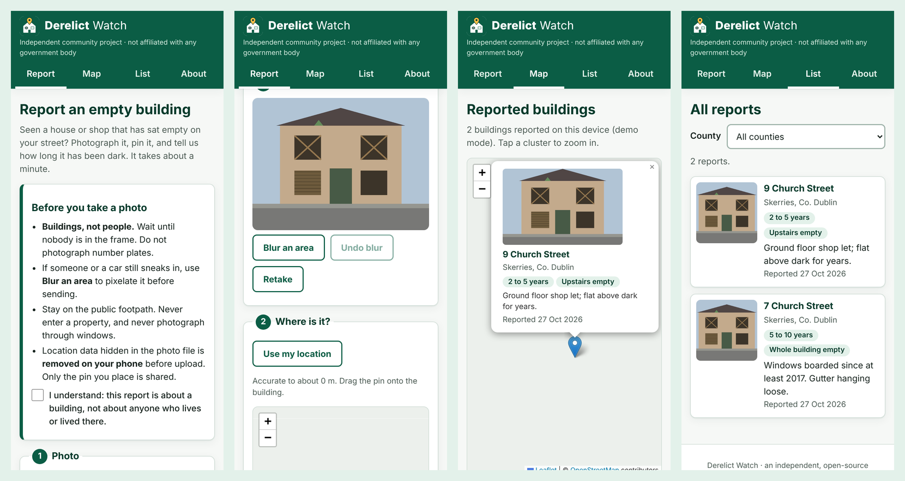

<p align="center">
  
</p>

<h1 align="center">Derelict Watch</h1>

<p align="center"><em>A nation of neighbours, phones in hand, taking the roll call of the empty houses.</em></p>

<p align="center">
  
  <br>
  <sub>The real app running in demo mode in headless Chromium, at phone size. The building is a drawn test image, and the map tiles are plain placeholders because the screenshot machine could not reach OpenStreetMap's servers. On a real phone you get the real street map.</sub>
</p>

---

## The ghosts on your street

Every town in Ireland has one. Usually it has several.

There's the terrace house with the curtains that haven't moved since the Celtic Tiger was a cub. There's the flat over the chemist, dark for a decade, while the queue for a room to rent goes round the block. There's the post piling up behind the door like snow that never melts, the buddleia growing out of the gutter like a flag of surrender, the slates sliding off one by one as if the roof were quietly giving up.

These are the ghosts of the housing crisis: not phantoms in white sheets but whole buildings, standing in plain sight, empty. And yet when the State sets out to count them, it moves at the speed of a committee. Surveys are commissioned, tendered, carried out, cross-checked and published, and by the time the ink is dry the figures are stale.

Meanwhile the people who *actually know* which houses are empty are walking past them every single day: the neighbours. The woman who walks the dog at seven. The lad on the bike delivering the chipper order. The pensioner who remembers exactly when the last family moved out ("the year of the big snow, it was"). Between them they hold a better vacancy register than any spreadsheet in any office, but it lives in their heads and nowhere else.

**Derelict Watch puts it on the map.** Open the app, point your phone at the empty building, drop a pin on its front door, tell us roughly how long it's been dark, and send. A minute's work. Multiply that minute by a street, a parish, a county, and the ghosts start to show up on the map.

> This is an independent community project. It is not run by, funded by, or affiliated with any government department, local authority or State body. See [Independence](#independence).

---

## How it works

1. **Read the photo guidance.** Buildings, not people. Tick the box to say you've understood.
2. **Take a photo.** The app opens your rear camera in the page. If the browser won't allow that, it falls back to your phone's own camera or photo picker. If a passer-by or a parked car has wandered into shot, tap **Blur an area** and drag a box over it to pixelate it.
3. **Pin it.** Tap **Use my location** for a GPS fix, then drag the pin onto the actual building, or just tap the map where it is.
4. **Fill in the facts:** house number or name, street, town, county, roughly how long it has been empty, whether **upstairs**, **downstairs** or both are empty, and any notes ("boarded windows, roof slates missing").
5. **Send.** If you have signal, the report goes straight up. If you're in a dead zone, it waits on your phone and goes the moment you're back online.
6. **See the map.** Every report appears on a public, clustered map and in a list you can filter by county.

---

## Features

| | |
|---|---|
| **Installable app (PWA)** | Web app manifest, maskable icons and a service worker. Add it to your home screen on iPhone or Android and it opens full-screen like a native app. No app store. |
| **Works offline** | The whole app shell, including Leaflet and the clustering plugin, is pre-cached, so the app opens with no signal. Map tiles you've already seen are kept (up to 400) for a patchy-signal fallback. |
| **Offline report queue** | Reports made offline are stored in **IndexedDB** with their photo and sent automatically when the connection returns: on the browser's `online` event, when you come back to the app, on start-up, and through Background Sync where the browser supports it (Chromium). Failed sends retry with exponential back-off (5 s, 10 s, 20 s … capped at 30 min) and pause after 8 attempts. The **About** tab shows anything still waiting, with **Try sending now** and **Discard**. |
| **No duplicates, ever** | Each report gets a UUID on the phone. The database column is `UNIQUE`, and photos are named after that UUID, so a retry after a half-finished upload is treated as already done rather than posted twice. |
| **Live camera capture** | `getUserMedia` with the rear camera, an on-screen shutter button, and a fallback to `<input type="file" accept="image/*" capture="environment">`. |
| **Privacy-first photos** | Downscaled to at most 1600 px on the long edge, re-encoded as JPEG, with **all EXIF/GPS metadata removed on the phone** before upload (see [Privacy](#privacy--ethics)). |
| **Blur tool** | Drag (or tap) on the photo to pixelate faces, number plates or anything else that shouldn't be there. Multiple boxes, with undo. |
| **GPS plus a hand on the pin** | Browser geolocation sets the starting point and shows its accuracy. The pin is draggable, and tapping the map moves it. |
| **Public map with clustering** | Leaflet and OpenStreetMap, with Leaflet.markercluster grouping nearby reports into numbered clusters that open as you zoom. Each popup shows the photo, address, how long it has been empty and which floors. |
| **List view** | Every report as a card, newest first, filterable by county. |
| **Sensible validation** | Required fields, length limits, the 26 counties, and a bounding box that rejects pins outside the island of Ireland. The same rules are enforced **again in the database**, so nobody can skip them by bypassing the app. |
| **Community moderation** | Anyone can flag a report. Three flags hide it automatically until a moderator looks at it. |
| **Demo mode** | With no Supabase configured, the app keeps reports in your own browser, so you can try every screen in ten seconds. |
| **Accessible, mobile-first** | Real `<label>`s, grouped fieldsets, a skip link, `aria-live` status messages, visible focus rings, touch targets of at least 44 px, keyboard-operable map pins, and respect for `prefers-reduced-motion`. |
| **No build step** | Plain ES modules, HTML and CSS. No framework, no bundler, no runtime dependencies to rot. |

### The "how long empty" bands

Nobody remembers the exact date a house went dark, so the app asks for a band rather than a falsely precise number:

`Less than 6 months` · `6 to 12 months` · `1 to 2 years` · `2 to 5 years` · `5 to 10 years` · `More than 10 years` · `Not sure`

Each band includes its lower bound and excludes its upper bound, so exactly 12 months is "1 to 2 years". The banding helpers (`bandFromMonths`, `bandFromDate`) live in `public/lib/banding.js` and are unit tested at every boundary.

---

## Privacy & ethics

A tool that points cameras at people's homes needs to behave itself. These are the rules, and the code that enforces each one:

**1. Buildings, not people.** The report screen opens with photo guidance: wait until nobody is in frame, don't photograph number plates, stay on the public footpath, never go onto the property, never photograph through windows. You tick a box before you can send. The notes field asks you not to name people.

**2. Blur what slipped through.** The **Blur an area** tool pixelates any region you drag over, *before* the photo is encoded, so the original pixels under the box never leave your phone.

**3. Metadata is stripped on the device, twice over.** Phone photos carry EXIF data that can include the exact GPS position, the time, and the make, model and serial number of the camera. Derelict Watch:
   - redraws every photo onto a `<canvas>` (downscaling it as it goes), which carries pixels only, so EXIF, XMP and ICC data from the original file are left behind; then
   - walks the resulting JPEG byte by byte and drops every APP1–APP15 segment, any non-JFIF APP0 and every COM (comment) segment, as a belt-and-braces guard (`stripJpegMetadata` in `public/lib/image.js`).

   The unit tests prove this against a real JPEG fixture carrying GPS coordinates, a camera model and a comment: after stripping, none of them remain and the image data is byte-for-byte unchanged. The only location that gets shared is **the pin you placed yourself**.

**4. No accounts, no tracking.** No sign-up, no names, no email addresses, no cookies, no analytics. The app stores nothing about who sent a report. (The one thing it keeps in your browser's `localStorage` is the list of reports *you* have flagged, so the button doesn't offer to flag them again.) Map tiles come from OpenStreetMap's servers, which see your IP address as any website would; this is stated on the About page.

**5. The database enforces the rules, not the app.** The Supabase anon key is public by design, so the security lives in Postgres:
   - anonymous users can **insert** reports and **read** visible ones, and nothing else;
   - **no updates and no deletes** for anonymous users: no policy permits them and no privilege is granted;
   - column-level grants mean the public can't set or even read `moderation_status`, `flag_count` or `client_id`;
   - `CHECK` constraints repeat the app's validation (county list, Irish bounding box, band values, length limits, at least one floor empty);
   - photos may only be uploaded as new `<uuid>.jpg` files of up to 5 MB, may not be overwritten or deleted, and the bucket can't be listed or browsed with the anon key.

**6. Moderation.** Every report has a `moderation_status` (`visible`, `hidden` or `approved`) and a `flag_count`. The **Flag a problem** button calls a tightly scoped database function, `flag_report()`, which can do exactly one thing: add one to the count. At three flags a report hides itself until a human has looked. Moderators work in the Supabase dashboard; `supabase/moderation.sql` has the review-queue query and the reinstate, hide and delete recipes. Reports marked `approved` can't be hidden by flags again.

Please use it kindly. An empty house can mean a death in the family, a long stay in hospital, or an inheritance tangled in probate. The point is to count the empty homes, not to shame anyone.

---

## Architecture

```
 Phone (PWA)                                          Supabase (your project)
 ┌──────────────────────────────────────────┐         ┌──────────────────────────────┐
 │ index.html + app.js (ES modules)         │         │ Postgres                     │
 │  ├─ lib/validation.js  rules & cleaning  │         │  └─ public.reports  + RLS    │
 │  ├─ lib/banding.js     "how long empty"  │  HTTPS  │     + CHECK constraints      │
 │  ├─ lib/image.js       downscale, strip  │ ──────► │     + flag_report() function │
 │  │                     EXIF, pixelate    │ PostgREST│                             │
 │  ├─ lib/queue.js       IndexedDB outbox  │ Storage │ Storage                      │
 │  └─ lib/api.js         Supabase / demo   │ ◄────── │  └─ report-photos (public    │
 │                                          │         │     read, insert-only)       │
 │ sw.js  app-shell cache, tile cache,      │         └──────────────────────────────┘
 │        Background Sync relay             │
 │ vendor/ Leaflet 1.9.4, markercluster     │ ◄────── tile.openstreetmap.org
 └──────────────────────────────────────────┘
```

- **No SDK.** `lib/api.js` talks to Supabase's REST (PostgREST) and Storage endpoints with plain `fetch`, so the app needs no build step and pulls nothing from a CDN.
- **Two interchangeable backends.** `SupabaseBackend` for the real thing; `LocalDemoBackend` (IndexedDB) when `config.js` is missing or still holds the placeholder values.
- **Submit order:** photo first (`<uuid>.jpg`), then the row. A retry that finds either one already there treats it as success. HTTP 4xx responses (apart from 408 and 429) are *permanent*: the report is dropped from the queue and you're told why, so a bad report can't loop forever. Network errors and 5xx responses are retried.
- **Config at deploy time.** `scripts/write-config.js` writes `public/config.js` from environment variables (it refuses a `service_role` or `sb_secret_` key). `config.js` is git-ignored.

```
derelict-watch/
├── public/                 the deployable site (no build step)
│   ├── index.html, app.js, styles.css, sw.js, manifest.webmanifest
│   ├── config.example.js   copy to config.js, or use `npm run config`
│   ├── lib/                pure, unit-tested modules
│   ├── icons/              SVG source + rendered PNGs (incl. maskable)
│   └── vendor/             Leaflet + Leaflet.markercluster (with licences)
├── supabase/
│   ├── schema.sql          table, constraints, grants, RLS, flag function, bucket
│   └── moderation.sql      moderator recipes
├── scripts/                dev server, config writer, shell checker, icon renderer
├── test/                   node:test suites + JPEG fixture
├── docs/screenshots.png
├── netlify.toml, vercel.json, .github/workflows/test.yml
└── LICENSE
```

---

## Supabase setup, step by step

You need a free Supabase account. Allow about ten minutes.

1. **Create a project.** At [supabase.com/dashboard](https://supabase.com/dashboard), choose **New project**. Pick the **West EU (Ireland)** region (`eu-west-1`) if you'd like the data to stay on the island. Set a strong database password and keep it somewhere safe.

2. **Run the schema.** Open **SQL Editor → New query**, paste in the whole of [`supabase/schema.sql`](supabase/schema.sql) and press **Run**. In one go this creates:
   - the `reports` table with its `CHECK` constraints and indexes;
   - the column-level `GRANT`s (anon can insert and select citizen-facing columns only);
   - **Row Level Security**, switched on, with two policies: *"Anyone can read visible reports"* (`SELECT` where `moderation_status <> 'hidden'`) and *"Anyone can submit a report"* (`INSERT` only as `visible` with zero flags);
   - the `flag_report(uuid)` function (`SECURITY DEFINER`, which can only add one to `flag_count` and auto-hides at three);
   - the **`report-photos` storage bucket**: public read, 5 MB limit, `image/jpeg` only;
   - the storage policy *"Anyone can upload a report photo"* (insert only, file name must be `<uuid>.jpg`).

   The script is idempotent, so you can safely run it again after editing it.

3. **Check it took.**
   - **Table Editor → reports** should show *RLS enabled*, and **Authentication → Policies** (in some dashboard versions, **Database → Policies**) should list the two policies above.
   - **Storage** should list `report-photos`, marked *Public*.

4. **Get your keys.** Go to **Project Settings → API Keys** (or the **Connect** button) and copy the **Project URL** and the **anon / publishable** key. Never use the `service_role` or secret key in the app: it bypasses every rule above.

5. **Point the app at it.** Either:
   ```bash
   cp public/config.example.js public/config.js   # then edit the two values
   ```
   or:
   ```bash
   SUPABASE_URL=https://abcd1234.supabase.co SUPABASE_ANON_KEY=eyJ... npm run config
   ```
   `public/config.js` is in `.gitignore`. The anon key is public by design (it ships to every browser anyway), but there is no reason to scatter it across git history.

6. **Moderate.** When reports get flagged, run the first query in [`supabase/moderation.sql`](supabase/moderation.sql) in the SQL Editor to see the review queue, then reinstate, hide or delete as needed.

---

## Run locally

Requirements: **Node.js 22 or newer**. There are no runtime dependencies. `npm install` fetches a single dev dependency (`fake-indexeddb`) for the tests.

```bash
git clone <your-fork-url> derelict-watch
cd derelict-watch
npm install
npm start            # → http://127.0.0.1:5173/
```

Without a `public/config.js` the app runs in **demo mode** and keeps reports in your browser, which is handy for a first look. Add a config (see above) and reload to use Supabase.

> **Camera and GPS need a secure context.** Browsers only allow them on `https://` or on `localhost`. Testing on your laptop works out of the box. To test on your phone, either deploy (see below, it takes two minutes) or tunnel your local server over HTTPS. `HOST=0.0.0.0 npm start` exposes the dev server on your LAN, but over plain `http://` your phone will refuse camera access, and the photo picker fallback will appear instead.

The service worker caches aggressively. After changing files, do a hard reload, or in DevTools tick **Application → Service workers → Update on reload**. Bump `VERSION` in `public/sw.js` when you release.

---

## Deploy

The `public/` folder *is* the site. Both hosts below run `npm run config` at build time to write `config.js` from environment variables, so your keys live in the host's settings, not in git.

### Netlify

1. **Add new site → Import an existing project** and pick your repository. `netlify.toml` already sets the publish directory (`public`) and build command.
2. Under **Site configuration → Environment variables**, add `SUPABASE_URL` and `SUPABASE_ANON_KEY`.
3. Deploy. `netlify.toml` also sends `no-cache` for `sw.js` and `config.js` (so updates arrive promptly) and a `Permissions-Policy` that allows camera and geolocation for the site only.

### Vercel

1. **Add New → Project**, import the repository. `vercel.json` sets the output directory (`public`), the build command and the same headers.
2. Add `SUPABASE_URL` and `SUPABASE_ANON_KEY` under **Settings → Environment Variables**.
3. Deploy.

Skip the environment variables on either host and you get a public **demo-mode** deployment: perfect for a portfolio link, with nothing to moderate.

---

## Install it as an app

**iPhone / iPad (Safari)**
1. Open the site in **Safari**.
2. Tap the **Share** button (the square with the arrow).
3. Choose **Add to Home Screen**, then **Add**.
4. Launch it from the home screen. The first time you take a photo or use your location, iOS will ask for permission. Say *Allow*.

**Android (Chrome)**
1. Open the site in **Chrome**.
2. Tap the **⋮** menu and choose **Install app** (on some versions, **Add to Home screen**). Chrome may also offer an install banner by itself.
3. Launch it from the home screen or app drawer.

Once installed, it opens full-screen in the green-and-white theme, works without signal, and sends queued reports when you reconnect.

---

## Tests

```bash
npm test             # node:test, 48 tests across 5 suites
npm run check:sw     # every file the service worker pre-caches really exists
```

| Suite | What it proves |
|---|---|
| `test/validation.test.js` | Required fields, trimming and control-character removal, case-insensitive county matching, the Irish bounding box (Malin Head and Mizen Head in, London out), the upstairs/downstairs rule, length limits, photo type and size rules, HTML escaping. |
| `test/banding.test.js` | Every band boundary, junk input falling to `unknown`, calendar-month arithmetic, and that the bands are contiguous with no gaps or overlaps. |
| `test/queue.test.js` | The IndexedDB outbox on **fake-indexeddb**: persistence across reopen, oldest-first ordering, removal on success, back-off timing, forced retries, permanent rejections, one bad entry not blocking the rest, the 8-attempt pause, no double-sending from concurrent flushes, and photo bytes surviving the round trip. |
| `test/image.test.js` | The downscale maths, and EXIF stripping against a **real JPEG carrying GPS coordinates, a camera model and a comment**: all three gone, scan data byte-identical, the JFIF header kept, idempotent, malformed input refused. Pixelation averages blocks and clamps at the edges. |
| `test/api.test.js` | The Supabase client against a fake `fetch`: request URLs and headers, upload-then-insert order, idempotent retries, which errors are permanent and which are retryable, public-column-only reads, the flag RPC, the demo backend, and the app-shell file list. |

CI runs the same checks on every push via GitHub Actions (`.github/workflows/test.yml`).

Not covered by unit tests: the canvas and camera code that only runs in a real browser (`fileToCanvas`, `canvasToCleanJpeg`, `getUserMedia`), and the SQL itself. Try those by hand: the app runs end to end in demo mode on `localhost`.

---

## Roadmap

Honest about what an MVP isn't yet:

- [ ] **Spam protection.** Anonymous inserts are open by design. Next steps are a CAPTCHA such as Cloudflare Turnstile, verified in a Supabase Edge Function, plus per-IP rate limits.
- [ ] **A proper moderator screen** (Supabase Auth plus a role), instead of the SQL Editor.
- [ ] **Duplicate detection:** "someone reported a building 10 m from here; is it the same one?"
- [ ] **Eircode** field and reverse geocoding to pre-fill the street and town.
- [ ] **Northern Ireland:** the bounding box already covers the whole island, but the county list is the 26 counties of the State.
- [ ] **As Gaeilge:** an Irish-language interface.
- [ ] **Open data export:** CSV and GeoJSON downloads under an open licence, so journalists, researchers and councillors can use the numbers.
- [ ] **"Still empty?" follow-ups**, so a report from 2026 can be confirmed or retired in 2027.
- [ ] Your own tile server or a commercial tile provider for heavy traffic, per the [OSM tile usage policy](https://operations.osmfoundation.org/policies/tiles/).

---

## Independence

**Derelict Watch is an independent, open-source community project.** It is not run by, funded by, endorsed by or affiliated with the Government of Ireland, any government department, any local authority, or any State body. It uses no State branding, emblems or insignia. A report made here is **not** an official record, is **not** a complaint or a notice to any authority, and does **not** trigger any statutory process. If you want a council to act on a derelict site, contact your local authority directly.

The name, wordmark and house-and-pin icon are original to this project.

---

## Licence

[MIT](LICENSE). Copyright © 2026 Niall O'Hara.

Bundled third-party code keeps its own licence: [Leaflet](https://leafletjs.com) 1.9.4 (BSD-2-Clause) and [Leaflet.markercluster](https://github.com/Leaflet/Leaflet.markercluster) 1.5.3 (MIT). See `public/vendor/`. Map data © [OpenStreetMap contributors](https://www.openstreetmap.org/copyright), available under the Open Database Licence.

*Go raibh maith agat for every pin you drop.*
